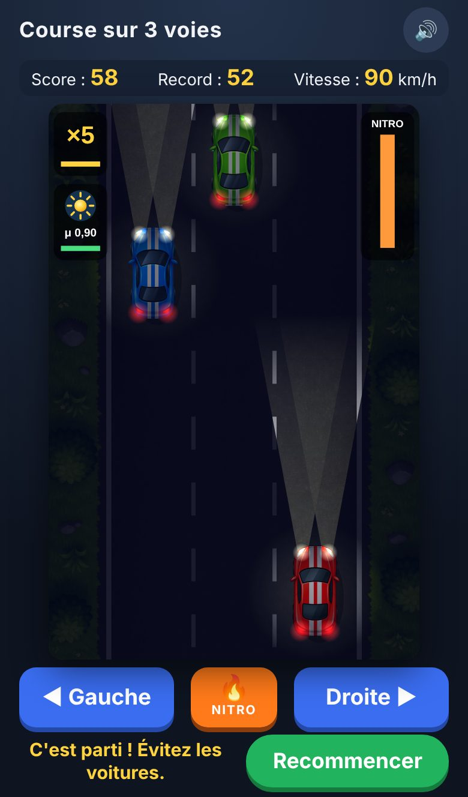
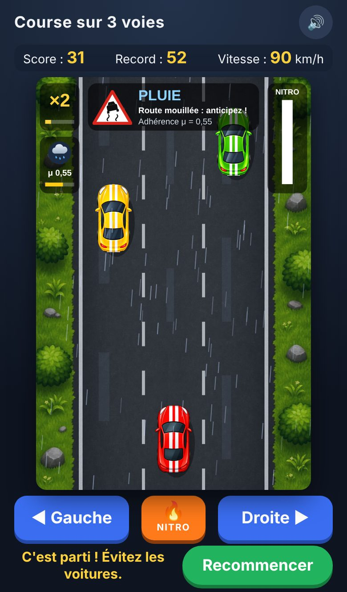
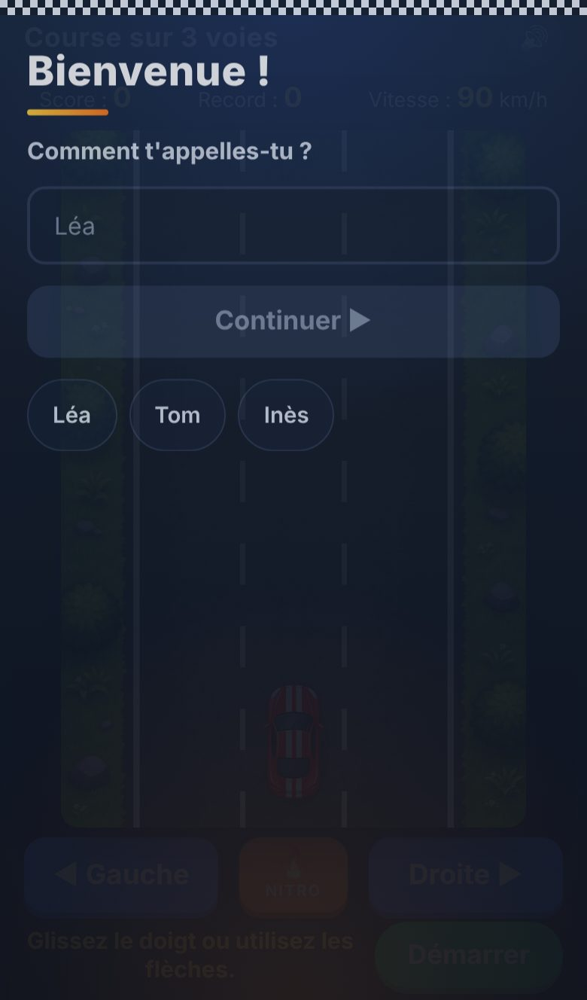
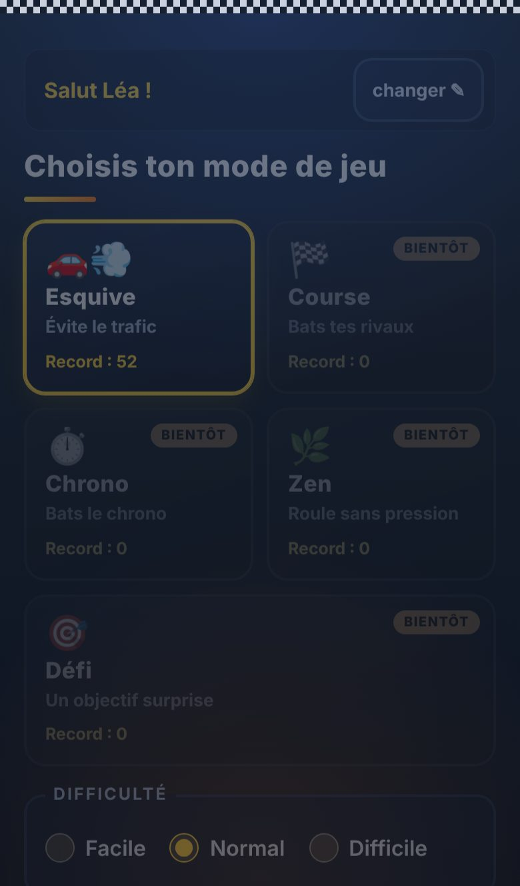
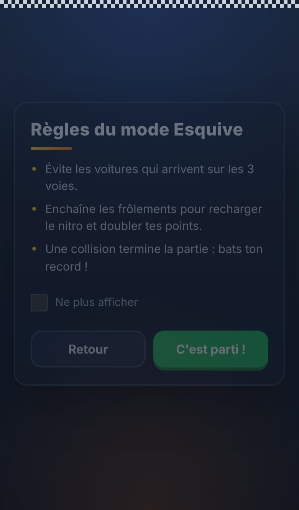
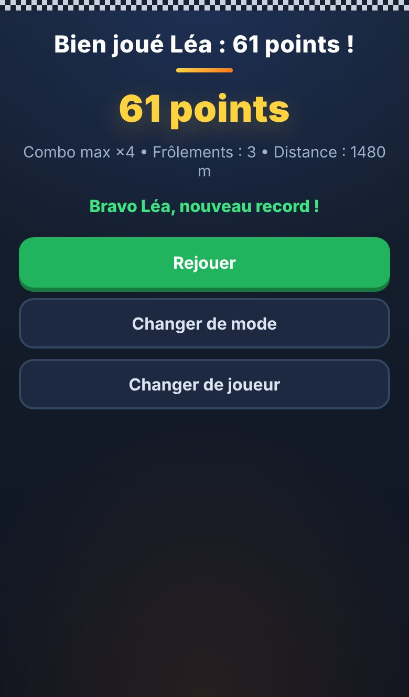

# 🏁 Jeu Aris — Course sur 3 voies

[](https://github.com/digitaleflex/jeu-aris/actions/workflows/ci.yml)


Un jeu de voiture en **JavaScript pur et Canvas 2D** : esquivez le trafic sur une route à trois
voies, prenez des risques pour marquer plus de points, et gardez le contrôle quand il pleut ou quand
la route gèle. On saisit son nom, on choisit un mode et une difficulté, et ses records sont gardés
pour chaque joueur. Il se joue au clavier, au doigt (swipe) ou avec les boutons à l'écran, sur
ordinateur comme sur téléphone.

<p align="center">
  
  
  
</p>

<p align="center">
  
  
  
  
</p>

## Ce qui rend le jeu particulier

- **Une physique fondée sur des unités réelles.** Moteur limité par la puissance et l'adhérence
  (`F = min(P / v, μ·m·g)`), traînée aérodynamique, résistance au roulement, choc avec
  conservation de la quantité de mouvement. La dynamique longitudinale est en unités SI ; la
  direction est simplifiée (seul le rapport entre les routes est réaliste). Tout est expliqué dans
  [`docs/PHYSIQUE.md`](docs/PHYSIQUE.md).
- **Une météo qui change la conduite.** L'adhérence μ passe de 0,90 (sec) à 0,55 (pluie) puis
  0,20 (verglas) : changements de voie plus lents, dérapages, flaques d'aquaplaning, plaques de glace.
- **Des sons 100 % synthétisés.** Aucun fichier audio : moteur à 6 rapports, crissement de pneus
  réaliste (adhérence-glissement), pluie, tonnerre, effet Doppler… Voir [`docs/AUDIO.md`](docs/AUDIO.md).
- **Du risque récompensé.** Combos jusqu'à ×5, frôlements, nitro qui double la puissance du moteur.
- **Un jeu à plusieurs joueurs sur le même appareil.** Nom, 3 niveaux de difficulté, records séparés
  par joueur et par mode.
- **Cycle jour / nuit**, avec des phares qui éclairent vraiment la route.
- **Aucune dépendance d'exécution** : pas de framework, pas de bibliothèque, pas de compilation.

## Jouer

### En ligne

Le jeu se publie tel quel avec **GitHub Pages** : _Settings → Pages → Deploy from a branch →
`main` / `/ (root)`_. Il est alors disponible sur `https://<compte>.github.io/jeu-aris/`.

### En local

Le code est découpé en modules JavaScript, qui ne se chargent pas depuis un fichier (`file://`) :
le jeu doit être servi par HTTP. Il faut [Node.js](https://nodejs.org) 22 ou plus.

```bash
git clone https://github.com/digitaleflex/jeu-aris.git
cd jeu-aris
npm start
```

Puis ouvrez <http://localhost:8080>. Sans Node.js, `python3 -m http.server 8080` fait aussi l'affaire.

> Pour tester sur téléphone, connectez-le au même réseau et ouvrez `http://<adresse-IP-de-l'ordinateur>:8080`.

## Commandes

**Pendant la partie**

| Action                  | Clavier         | Écran tactile                                      | Boutons      |
| ----------------------- | --------------- | -------------------------------------------------- | ------------ |
| Voie de gauche          | `←` `Q` `A`     | glisser vers la gauche (ou toucher le côté gauche) | **◀ Gauche** |
| Voie de droite          | `→` `D`         | glisser vers la droite (ou toucher le côté droit)  | **Droite ▶** |
| Nitro                   | `↑` `Z` `W` `⇧` | glisser vers le haut                               | **🔥 Nitro** |
| Couper / activer le son | `M`             | —                                                  | **🔊**       |

Un long swipe peut enchaîner plusieurs voies d'un coup. Les écrans gèrent leurs propres touchers :
un toucher sur un écran ne déclenche jamais un geste de jeu.

**Dans les écrans**

| Écran         | Ce qu'on peut faire                                                                                                                             |
| ------------- | ----------------------------------------------------------------------------------------------------------------------------------------------- |
| Accueil       | taper son nom (2 à 12 caractères : lettres, chiffres, espace, tiret), `Entrée` ou **Continuer** ; les 3 derniers noms se choisissent en un clic |
| Choix du mode | `←` `→` `↑` `↓` pour passer d'une carte à l'autre, `Entrée` pour ouvrir les règles, `Échap` pour revenir à l'accueil ; choix de la difficulté   |
| Règles        | **C'est parti !** lance la partie, **Retour** revient aux modes ; « Ne plus afficher » est mémorisé                                             |
| Fin de partie | `Espace` / `Entrée` ou toucher l'écran (hors boutons) = rejouer ; **Changer de mode**, **Changer de joueur**                                    |

## Règles

- **Évitez les voitures.** Chaque voiture dépassée rapporte 1 point × le multiplicateur de combo.
  Un choc termine la partie.
- **Combo** : toutes les 5 voitures évitées d'affilée, le multiplicateur monte (×2 … ×5). Changer de
  voie alors qu'aucune voiture n'arrive dans la vôtre le fait retomber.
- **Frôlement** : dépasser une voiture à moins de 16 px donne +2 points, un petit ralenti et recharge
  le nitro.
- **Nitro** : jauge pleine = 3 s avec un moteur 2,2 fois plus puissant et des points doublés.
- **Météo** : après quelques secondes, il pleut ou il gèle. L'adhérence μ est affichée à gauche de la
  route et devient rouge sur une flaque ou une plaque de verglas.
- La vitesse visée monte avec chaque voiture évitée, jusqu'à la vitesse maximale de la difficulté.

### Modes de jeu

| Mode             | État    | But                                          |
| ---------------- | ------- | -------------------------------------------- |
| 🚗💨 **Esquive** | jouable | éviter le trafic, battre son record          |
| 🏁 Course        | bientôt | battre des rivaux jusqu'à la ligne d'arrivée |
| ⏱️ Chrono        | bientôt | parcourir la distance le plus vite possible  |
| 🌿 Zen           | bientôt | rouler sans collision fatale                 |
| 🎯 Défi          | bientôt | remplir un objectif avant la fin du temps    |

### Difficulté

Choisie à l'écran des modes et mémorisée. Un seul tableau (`src/config/difficultes.js`) règle tout :

| Réglage                 | Facile   | Normal   | Difficile |
| ----------------------- | -------- | -------- | --------- |
| Vitesse de départ       | 70 km/h  | 90 km/h  | 110 km/h  |
| Vitesse maximale        | 140 km/h | 180 km/h | 220 km/h  |
| Densité du trafic       | × 0,7    | × 1      | × 1,3     |
| Chance de verglas       | 15 %     | 30 %     | 50 %      |
| Multiplicateur de score | × 0,8    | × 1      | × 1,3     |

Après une période de route sèche, le jeu choisit un mauvais temps : la « chance de verglas » est la
probabilité que ce soit du verglas plutôt que de la pluie. Les réglages « réflexe des rivaux » et
« temps par point de passage » attendent les modes à venir.

### Records

Chaque joueur a son record **par mode**, gardé dans le navigateur (`record.<mode>.<nom>`). L'ancien
record unique est repris pour le premier joueur qui saisit son nom.

## Pour les développeurs

```
index.html            page du jeu (point d'entrée : src/main.js)
css/style.css         mise en page, responsive, écrans
images/               route, voitures, icônes météo (SVG)
src/
  config/             constantes, véhicules, météo, difficultés, règles (aucune logique)
  etat/               état d'une partie, phases, navigation entre écrans, préférences et records
  route/              géométrie de la route (nombre de voies variable)
  physique/           moteur, direction, collisions, frottement
  meteo/              météo, adhérence, flaques, effets
  systemes/           trafic, score et combos, nitro, accident, particules
  modes/              les modes de jeu (données + crochets) et les règles standard d'une partie
  environnement/      cycle jour / nuit
  rendu/              dessin Canvas
  audio/              sons synthétisés (Web Audio)
  entrees/            clavier, tactile, boutons
  ui/                 HUD (score, messages) et écrans HTML (nom, modes, règles, fin)
tests/                unitaires (Node) et bout en bout (Playwright)
docs/                 architecture, physique, audio, feuille de route
```

Le cœur du jeu (`etat`, `physique`, `meteo`, `systemes`, `modes`, `simulation.js`) **ne touche ni au
DOM ni au son** : il tourne sous Node, ce qui permet de le tester sans navigateur.

```bash
npm install          # outils de développement (lint, tests)
npm test             # tests unitaires, sans navigateur (≈ 1 s)
npm run lint         # ESLint
npm run format       # Prettier
npm run test:e2e     # tests dans un vrai navigateur (nécessite : npx playwright install chromium)
```

Pour aller plus loin : [`docs/ARCHITECTURE.md`](docs/ARCHITECTURE.md) explique les couches, le
déroulement d'un pas de simulation et comment ajouter un mode, un véhicule ou une météo.

## Feuille de route

Les évolutions prévues sont suivies dans les [issues](https://github.com/digitaleflex/jeu-aris/issues) :
les autres modes (course avec rivaux, contre-la-montre, zen, défi), des routes à nombre de voies
variable, de nouveaux véhicules, de nouveaux temps (brouillard, neige…). Voir
[`docs/FEUILLE-DE-ROUTE.md`](docs/FEUILLE-DE-ROUTE.md).

## Contribuer

Les contributions sont bienvenues : lisez [`CONTRIBUTING.md`](CONTRIBUTING.md) et le
[code de conduite](CODE_OF_CONDUCT.md). Pour signaler une faille, voir [`SECURITY.md`](SECURITY.md).

## Licence

**Aucune licence n'est encore choisie** : sans licence, le code ne peut pas être réutilisé librement.
Le choix est à faire par les mainteneurs avant toute redistribution. Les images (voitures, route) sont
fournies par le projet ; leur provenance doit être documentée avant toute redistribution.

## Origine du projet

Le jeu est né d'un TP guidé de L1 (« JavaScript & Canvas ») : route à trois voies, voiture contrôlée
au clavier et par boutons, obstacles, score, collisions et bouton Recommencer. Toutes ces exigences
restent satisfaites par le mode Esquive. Depuis, le code a été découpé en modules ES (voir
[`docs/DECISIONS.md`](docs/DECISIONS.md)), ce qui remplace le `script.js` unique du TP.

---

### English summary

**Jeu Aris** is a dependency-free browser racing game built with vanilla JavaScript (ES modules) and
Canvas 2D: dodge traffic on a three-lane road with real-unit longitudinal physics (engine power vs.
tyre grip μ·m·g, drag, momentum-conserving crashes), dynamic weather (rain, ice) that changes grip,
nitro, combos, a day/night cycle with headlights, player names with per-mode records, three
difficulty levels, and fully synthesised Web Audio sound. Run `npm start` and
open <http://localhost:8080>. The simulation core has no DOM dependency and is covered by unit tests
(`npm test`). Documentation is currently in French; see `docs/ARCHITECTURE.md`.
