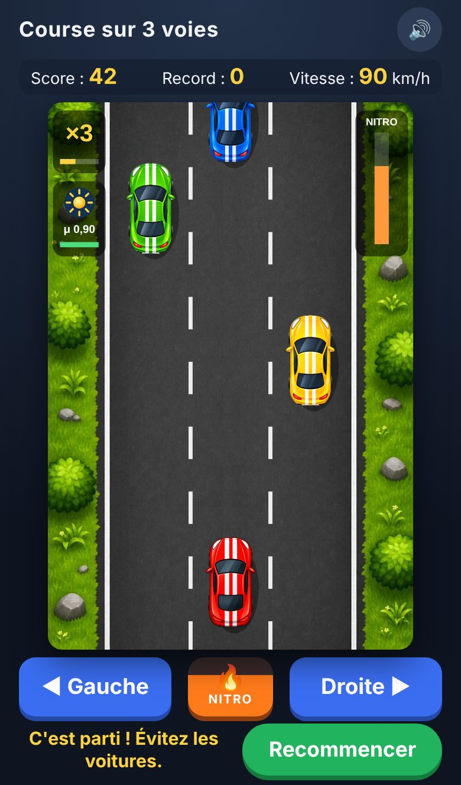

# 🏁 Jeu Aris — Course sur 3 voies

[](https://github.com/digitaleflex/jeu-aris/actions/workflows/ci.yml)


Un jeu de voiture en **JavaScript pur et Canvas 2D** : esquivez le trafic sur une route à trois
voies, prenez des risques pour marquer plus de points, et gardez le contrôle quand il pleut ou quand
la route gèle. Il se joue au clavier, au doigt (swipe) ou avec les boutons à l'écran, sur ordinateur
comme sur téléphone.

<p align="center">
  
  
  
</p>

## Ce qui rend le jeu particulier

- **Une physique fondée sur des unités réelles.** Moteur limité par la puissance et l'adhérence
  (`F = min(P / v, μ·m·g)`), traînée aérodynamique, résistance au roulement, choc avec
  conservation de la quantité de mouvement. La dynamique longitudinale est en unités SI ; la
  direction est simplifiée (seul le rapport entre les routes est réaliste). Tout est expliqué dans
  [`docs/PHYSIQUE.md`](docs/PHYSIQUE.md).
- **Une météo qui change la conduite.** L'adhérence μ passe de 0,90 (sec) à 0,55 (pluie) puis
  0,20 (verglas) : changements de voie plus lents, dérapages, flaques d'aquaplaning, plaques de glace.
- **Des sons 100 % synthétisés.** Aucun fichier audio : moteur à 6 rapports, crissement de pneus
  réaliste (adhérence-glissement), pluie, tonnerre, effet Doppler… Voir [`docs/AUDIO.md`](docs/AUDIO.md).
- **Du risque récompensé.** Combos jusqu'à ×5, frôlements, nitro qui double la puissance du moteur.
- **Cycle jour / nuit**, avec des phares qui éclairent vraiment la route.
- **Aucune dépendance d'exécution** : pas de framework, pas de bibliothèque, pas de compilation.

## Jouer

### En ligne

Le jeu se publie tel quel avec **GitHub Pages** : *Settings → Pages → Deploy from a branch →
`main` / `/ (root)`*. Il est alors disponible sur `https://<compte>.github.io/jeu-aris/`.

### En local

Le code est découpé en modules JavaScript, qui ne se chargent pas depuis un fichier (`file://`) :
le jeu doit être servi par HTTP. Il faut [Node.js](https://nodejs.org) 22 ou plus.

```bash
git clone https://github.com/digitaleflex/jeu-aris.git
cd jeu-aris
npm start
```

Puis ouvrez <http://localhost:8080>. Sans Node.js, `python3 -m http.server 8080` fait aussi l'affaire.

> Pour tester sur téléphone, connectez-le au même réseau et ouvrez `http://<adresse-IP-de-l'ordinateur>:8080`.

## Commandes

| Action               | Clavier           | Écran tactile                                   | Boutons         |
| -------------------- | ----------------- | ----------------------------------------------- | --------------- |
| Voie de gauche       | `←` `Q` `A`       | glisser vers la gauche (ou toucher le côté gauche) | **◀ Gauche**    |
| Voie de droite       | `→` `D`           | glisser vers la droite (ou toucher le côté droit)  | **Droite ▶**    |
| Nitro                | `↑` `Z` `W` `⇧`   | glisser vers le haut                            | **🔥 Nitro**    |
| Démarrer / rejouer   | `Espace` `Entrée` | toucher l'écran                                 | **Recommencer** |
| Couper / activer le son | `M`            | —                                               | **🔊**          |

Un long swipe peut enchaîner plusieurs voies d'un coup.

## Règles

- **Évitez les voitures.** Chaque voiture dépassée rapporte 1 point × le multiplicateur de combo.
  Un choc termine la partie.
- **Combo** : toutes les 5 voitures évitées d'affilée, le multiplicateur monte (×2 … ×5). Changer de
  voie alors qu'aucune voiture n'arrive dans la vôtre le fait retomber.
- **Frôlement** : dépasser une voiture à moins de 16 px donne +2 points, un petit ralenti et recharge
  le nitro.
- **Nitro** : jauge pleine = 3 s avec un moteur 2,2 fois plus puissant et des points doublés.
- **Météo** : après quelques secondes, il pleut ou il gèle. L'adhérence μ est affichée à gauche de la
  route et devient rouge sur une flaque ou une plaque de verglas.
- La vitesse visée monte avec chaque voiture évitée (de 90 à 180 km/h).

## Pour les développeurs

```
index.html            page du jeu (point d'entrée : src/main.js)
css/style.css         mise en page, responsive, thème
images/               route, voitures, icônes météo (SVG)
src/
  config/             constantes, véhicules, météo, règles (aucune logique)
  etat/               état d'une partie et ses phases
  route/              géométrie de la route (nombre de voies variable)
  physique/           moteur, direction, collisions, frottement
  meteo/              météo, adhérence, flaques, effets
  systemes/           trafic, score et combos, nitro, accident, particules
  modes/              règles d'un mode de jeu (aujourd'hui : Esquive)
  environnement/      cycle jour / nuit
  rendu/              dessin Canvas
  audio/              sons synthétisés (Web Audio)
  entrees/            clavier, tactile, boutons
  ui/                 affichage HTML (score, messages)
tests/                unitaires (Node) et bout en bout (Playwright)
docs/                 architecture, physique, audio, feuille de route
```

Le cœur du jeu (`etat`, `physique`, `meteo`, `systemes`, `modes`, `simulation.js`) **ne touche ni au
DOM ni au son** : il tourne sous Node, ce qui permet de le tester sans navigateur.

```bash
npm install          # outils de développement (lint, tests)
npm test             # tests unitaires, sans navigateur
npm run lint         # ESLint
npm run format       # Prettier
npm run test:e2e     # tests dans un vrai navigateur (nécessite : npx playwright install chromium)
```

Pour aller plus loin : [`docs/ARCHITECTURE.md`](docs/ARCHITECTURE.md) explique les couches, le
déroulement d'un pas de simulation et comment ajouter un mode, un véhicule ou une météo.

## Feuille de route

Les évolutions prévues sont suivies dans les [issues](https://github.com/digitaleflex/jeu-aris/issues) :
modes de jeu (course, contre-la-montre…), écran d'accueil, routes à nombre de voies variable,
nouveaux véhicules. Voir [`docs/FEUILLE-DE-ROUTE.md`](docs/FEUILLE-DE-ROUTE.md).

## Contribuer

Les contributions sont bienvenues : lisez [`CONTRIBUTING.md`](CONTRIBUTING.md) et le
[code de conduite](CODE_OF_CONDUCT.md). Pour signaler une faille, voir [`SECURITY.md`](SECURITY.md).

## Licence

**Aucune licence n'est encore choisie** : sans licence, le code ne peut pas être réutilisé librement.
Le choix est à faire par les mainteneurs (voir l'issue dédiée). Les images (voitures, route) sont
fournies par le projet ; leur provenance doit être documentée avant toute redistribution.

## Origine du projet

Le jeu est né d'un TP guidé de L1 (« JavaScript & Canvas ») : route à trois voies, voiture contrôlée
au clavier et par boutons, obstacles, score, collisions et bouton Recommencer. Toutes ces exigences
restent satisfaites par le mode Esquive.

---

### English summary

**Jeu Aris** is a dependency-free browser racing game built with vanilla JavaScript (ES modules) and
Canvas 2D: dodge traffic on a three-lane road with real-unit physics (engine power vs. tyre grip
μ·m·g, drag, momentum-conserving crashes), dynamic weather (rain, ice) that changes grip, nitro,
combos, a day/night cycle with headlights, and fully synthesised Web Audio sound. Run `npm start` and
open <http://localhost:8080>. The simulation core has no DOM dependency and is covered by unit tests
(`npm test`). Documentation is currently in French; see `docs/ARCHITECTURE.md`.
