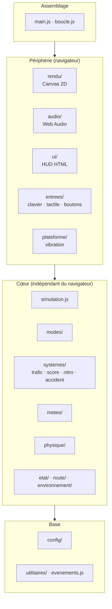
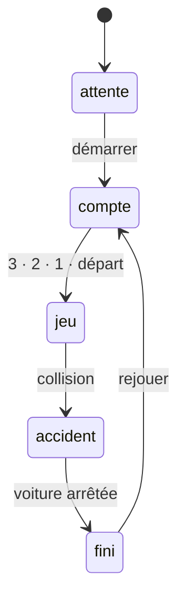
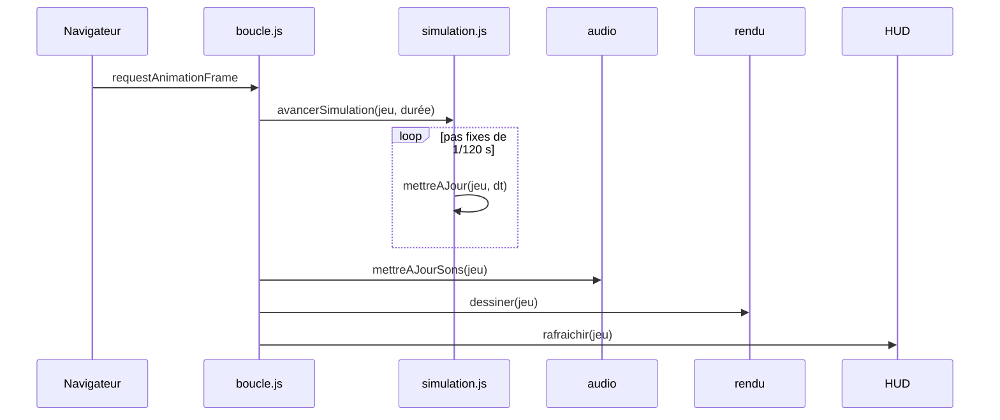

# Architecture

Ce document explique comment le code est organisé, pourquoi, et comment le faire évoluer. Les règles
qu'il énonce sont **vérifiées automatiquement** par `tests/unitaires/architecture.test.js` : si
l'architecture dérive, la CI échoue.

## Principes

1. **Le cœur du jeu ne connaît pas le navigateur.** Physique, règles, météo et simulation tournent
   sous Node, sans DOM, sans Canvas, sans son. C'est ce qui permet de les tester vite et de les
   rejouer à l'identique.
2. **Un seul état, des fonctions qui le font évoluer.** L'état d'une partie est un objet (`EtatJeu`)
   passé en premier paramètre. Il n'y a pas de variable globale modifiable.
3. **Les règles émettent des événements, les autres réagissent.** Une voiture évitée émet
   `depassement` ; l'audio joue un son, sans que les règles sachent qu'il existe un son.
4. **Le hasard du gameplay est injecté** (`jeu.alea`) : la même graine rejoue la même partie.
5. **Rien n'est codé en dur** : le nombre de voies, les caractéristiques d'un véhicule et les
   réglages de conduite sont des données (`src/config`, `route`), pas des constantes dispersées.

## Les couches



Une couche ne peut importer que sa propre couche et celles du dessous. Concrètement :

| Couche         | Dossiers et fichiers                                                                 | Peut importer                  |
| -------------- | ------------------------------------------------------------------------------------ | ------------------------------ |
| **Base**       | `config/`, `utilitaires/`, `evenements.js`                                           | base                           |
| **Cœur**       | `etat/`, `route/`, `physique/`, `meteo/`, `systemes/`, `modes/`, `environnement/`, `simulation.js` | base, cœur       |
| **Périphérie** | `rendu/`, `audio/`, `ui/`, `entrees/`, `plateforme/`                                 | base, cœur, périphérie         |
| **Assemblage** | `main.js`, `boucle.js`                                                               | tout                           |

## Plan des modules

| Dossier          | Rôle                                                                                          |
| ---------------- | --------------------------------------------------------------------------------------------- |
| `config/`        | Données : constantes, `VEHICULES`, `METEOS`, réglages, règles (nitro, combos…). Pas de logique. |
| `etat/`          | `creerEtatJeu`, `reinitialiserPartie`, `PHASES` ; `phases.js` : départ, compte à rebours, fin.  |
| `route/`         | `creerRoute({ nbVoies, gauche, largeur })` : géométrie, `centreVoie(n)`.                       |
| `physique/`      | `moteur.js` (F = ma), `direction.js` (ressort amorti, glisse, traces), `collisions.js`, `frottement.js`. |
| `meteo/`         | `conditions.js` (adhérence μ, fonctions pures), `meteo.js` (évolution), `dangers.js` (flaques, plaques), `effets.js` (gouttes, flocons). |
| `systemes/`      | `trafic.js`, `score.js` (points, combos, frôlements), `nitro.js`, `accident.js`, `pilotage.js` (changer de voie), `particules.js`. |
| `modes/`         | Règles d'un mode de jeu (`esquive.js`). Voir « Ajouter un mode ».                              |
| `environnement/` | `cycleJour.js` : obscurité et teinte du ciel selon la distance.                                |
| `simulation.js`  | `mettreAJour(jeu, dt)` : un pas de simulation ; `avancerSimulation` : pas fixes.               |
| `rendu/`         | Dessin par couches : route, véhicules, particules, ambiance (nuit), interface.                  |
| `audio/`         | Contexte Web Audio, sons continus (moteur, pneus), effets, branchement sur les événements.     |
| `ui/`            | `hud.js` : score, record, vitesse, message, boutons.                                           |
| `entrees/`       | `clavier.js`, `tactile.js`, `boutons.js` → tous appellent les mêmes `commandes`.               |
| `boucle.js`      | `requestAnimationFrame` : simulation → sons → dessin → HUD.                                    |
| `main.js`        | Assemble tout. Expose `window.jeuAris` pour le débogage et les tests.                          |

## L'état d'une partie

`creerEtatJeu()` renvoie un `EtatJeu` (voir les types JSDoc dans `src/etat/jeu.js`). Ses grandes parties :

- **Contexte** : `route`, `mode`, `reglages`, `alea`, `evenements`.
- **Déroulement** : `phase`, `score`, `record`, `compteARebours`, `message`.
- **Voitures** : `joueur` (une `Voiture`), `obstacles` (le trafic).
- **Systèmes** : `nitro`, `meteo`, `dangers`, `particules`, `traces`, `textesFlottants`.
- **Effets de jeu** : `serie` (combo), `tremblement`, `ralentiRestant`, `defilement` (distance).

### Phases



## Un pas de simulation

`mettreAJour(jeu, dt)` (`src/simulation.js`) est appelée à pas fixe (1/120 s). L'ordre compte :

1. **Joueur** : moteur puis direction (phases `compte` et `jeu`), ou glissade (phase `accident`).
2. **Monde** : défilement de la route, déplacement du trafic.
3. **Systèmes communs** : nitro, météo (et dangers), particules, textes flottants.
4. **Règles de la phase** : compte à rebours, ou `jeu.mode.mettreAJourPartie(jeu, dt)`.

`avancerSimulation(jeu, tempsReel)` convertit le temps réel en pas fixes (accumulateur), limite le
temps à 0,1 s et applique les ralentis. La physique est donc identique à 60, 120 ou 144 Hz.



## Événements

Les règles émettent des événements via `jeu.evenements.emettre(nom, données)`. La liste complète est
documentée dans `src/evenements.js`. Exemples : `depassement`, `frolement`, `combo`, `accident`,
`meteo`, `danger`, `vibration`, `fin`.

Les écouteurs sont branchés dans `main.js` : `brancherAudio(jeu)` (sons) et `brancherVibration(jeu)`.
Ajouter une réaction (une statistique, un nouveau son) ne demande **aucune modification des règles**.

L'interface HTML, elle, ne reçoit aucun événement : elle compare l'état à ce qu'elle affiche à chaque
image (`ui/hud.js`).

## Le hasard

| Besoin                                        | À utiliser                |
| --------------------------------------------- | ------------------------- |
| Ce qui change la partie (trafic, météo, choc)  | `jeu.alea()`              |
| Effets purement visuels ou sonores (particules, tremblement, notes) | `Math.random()` |

`jeu.alea` vaut `Math.random` par défaut. Avec `creerAleaAvecGraine(n)`, la partie est rejouable à
l'identique (tests, futur « défi du jour »). Le test d'architecture refuse `Math.random` dans les
fichiers qui décident du gameplay, et `tests/unitaires/jeu.test.js` vérifie que les effets visuels
n'influencent jamais le résultat.

## Rendu

`rendu.dessiner(jeu)` dessine toujours dans un repère logique de **360 × 540**. `ajusterTaille`
choisit la taille d'affichage et le nombre de pixels réels (densité de l'écran) ; les fonctions de
dessin n'en savent rien. Couches, du fond vers le dessus :

route → chaussée (mouillée / givrée) → dangers → traces → particules au sol → voitures → particules
en l'air → **ambiance** (coucher de soleil, nuit, phares) → givre → textes flottants → *(sans
tremblement)* interface → annonce météo → écrans de texte.

La nuit utilise un calque séparé : on le remplit d'obscurité puis on « efface » les cônes de phares
(`destination-out`) avant de l'afficher.

## Recettes

### Ajouter un mode de jeu

Un mode est un objet qui implémente le type `Mode` (voir `src/modes/esquive.js`) :

```js
export const modeChrono = {
  id: 'chrono',
  nom: 'Contre-la-montre',
  messageDepart: 'Passez les checkpoints avant la fin du temps !',
  chargerRecord: () => 0,
  preparer(jeu) { /* état propre au mode */ },
  mettreAJourPartie(jeu, dt) { /* règles : trafic, chrono, fin de partie… */ },
  enregistrerResultat(jeu) { return { nouveauRecord: false }; },
};
```

Puis `creerEtatJeu({ mode: modeChrono })`. Le mode **compose** les systèmes existants
(`creerVaguesDeTrafic`, `verifierObstaclesEvites`, `detecterCollision`…) ; il ne duplique pas la
physique.

### Ajouter un véhicule

Ajoutez une entrée dans `VEHICULES` (`src/config/vehicules.js`) avec `creerCaracteristiques({…})` :
masse, puissance, adhérence, Cx, surface frontale, direction. Passez-la à
`creerEtatJeu({ vehicule: VEHICULES.maVoiture })`. Toute la physique lit `joueur.caracteristiques`.

### Ajouter une route à N voies

```js
import { creerRoute } from './route/route.js';
creerEtatJeu({ route: creerRoute({ nbVoies: 5, gauche: 40, largeur: 280 }) });
```

Trafic, dangers, pilotage, rebonds et marquages lisent `route.nbVoies` / `route.centreVoie(n)`.
Limites actuelles : voies de même largeur, route droite, et le décor (`images/route.jpg`) est dessiné
pour 3 voies (seuls les marquages s'adaptent).

### Ajouter une météo

1. Ajoutez la condition dans `METEOS` (`src/config/meteo.js`) : adhérence, vitesse max, crissement.
2. Gérez son intensité dans `etat/jeu.js` (`Meteo`) et sa transition dans `meteo/meteo.js`.
3. Ajoutez ses effets visuels (`rendu/route.js`, `meteo/effets.js`) et ses sons (`audio/effets.js`).

### Ajouter un son

Écrivez la fonction dans `audio/effets.js`, puis reliez-la à un événement dans `brancherAudio`
(`audio/audio.js`). Si aucun événement ne convient, émettez-en un depuis la règle concernée et
documentez-le dans `src/evenements.js`.

## Tests

| Niveau              | Dossier           | Ce qu'il vérifie                                                  | Vitesse |
| ------------------- | ----------------- | ----------------------------------------------------------------- | ------- |
| Unitaires           | `tests/unitaires` | physique, règles, météo, route, hasard, **architecture**          | ~1 s    |
| Bout en bout        | `tests/e2e`       | chargement, responsive, clavier, swipe, nitro, partie complète    | ~20 s   |

Le **test de caractérisation** (`jeu.test.js`) fige le comportement d'une partie de référence. Si
vous changez volontairement le gameplay, mettez ses valeurs à jour dans la même PR et expliquez
pourquoi.

## Conventions

- **Langue** : le vocabulaire du domaine est en français (`voie`, `adherence`, `obstacles`), comme
  le projet et ses issues. Les termes techniques courants restent en anglais (`canvas`, `ctx`).
- **Style** : ESLint + Prettier (`npm run lint`, `npm run format`), 2 espaces, guillemets simples.
- **Documentation** : JSDoc sur toute fonction exportée ; les unités sont dans les noms ou les
  commentaires (`px`, `m/s`, `km/h`, `s`).
- **Unités** : la simulation est en pixels et secondes ; les conversions passent par
  `kmhVersPx` / `pxVersKmh` et `PX_PAR_METRE`.
